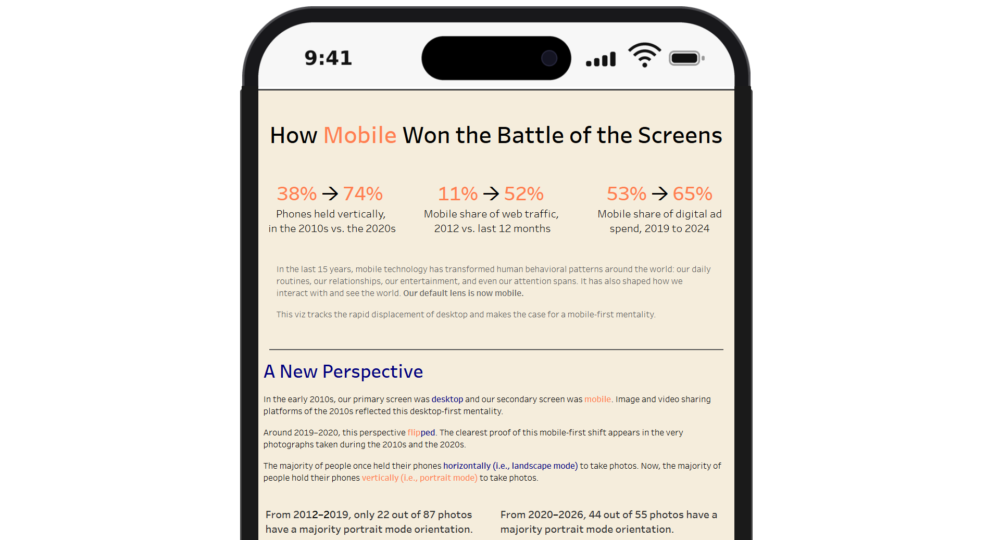

  

   
  Data Analyst with a passion for visual storytelling, culture, world history, and learning about the technology that shapes our lives.

  

 

- <b>Portfolio Highlight:</b> <a href="https://public.tableau.com/app/profile/david.boucard/viz/HowMobileWontheBattleoftheScreens/Dashboard1">How Mobile Won the Battle of the Screens</a>

- <b>Projects in the Works:</b> MTA/Citibike data analysis dashboard in Power BI | Collaboration with <a href="https://github.com/hperez1718-byte" target="_blank">@hperez1718-byte</a> and <a href="https://github.com/fayedtishad" target="_blank">@fayedtishad</a>
- <b>Education:</b> B.S. in Electrical Engineering from Columbia University 🦁
- <b>How to Reach Me:</b> <a href="https://www.linkedin.com/in/david-boucard-19318246/">LinkedIn</a> or email me at dursus1214@gmail.com

 

<!--
**dursus/dursus** is a ✨ _special_ ✨ repository because its `README.md` (this file) appears on your GitHub profile.

Here are some ideas to get you started:

- 🔭 I’m currently working on ...
- 🌱 I’m currently learning ...
- 👯 I’m looking to collaborate on ...
- 🤔 I’m looking for help with ...
- 💬 Ask me about ...
- 📫 How to reach me: ...
- 😄 Pronouns: ...
- ⚡ Fun fact: ...
-->
